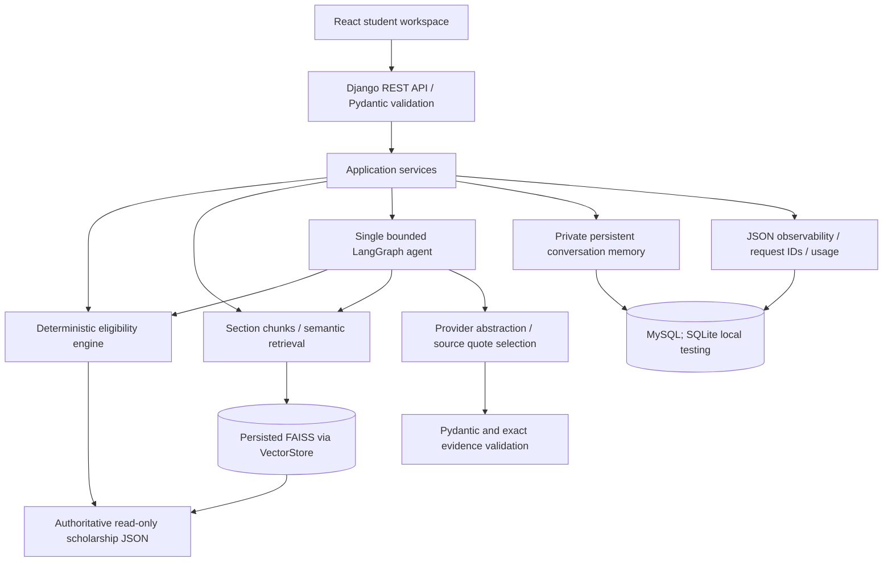
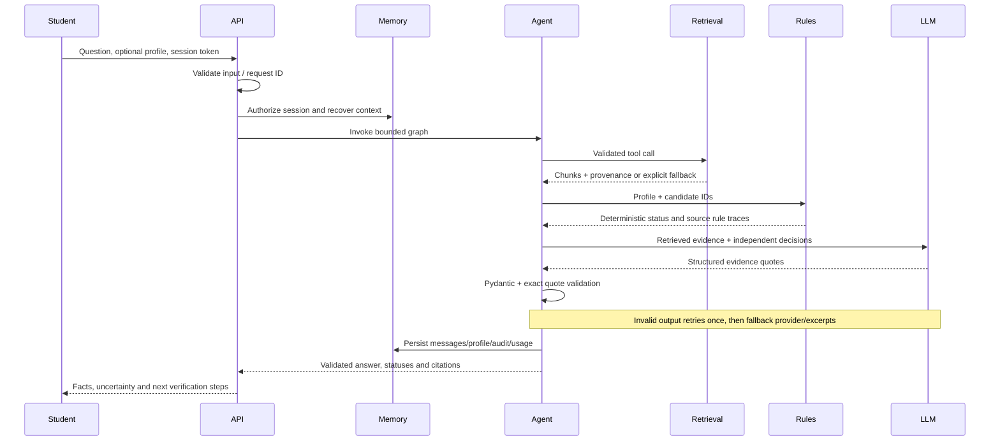

# Architecture

Facts: corpus. Decisions: rules. Language: constrained provider. Orchestration:
single graph. SQL stores operational metadata, session profiles/messages,
executions/tool calls/usage and evaluations; corpus content is not copied into SQL.
Chunks and embeddings live in versioned index files. No microservices are needed.
