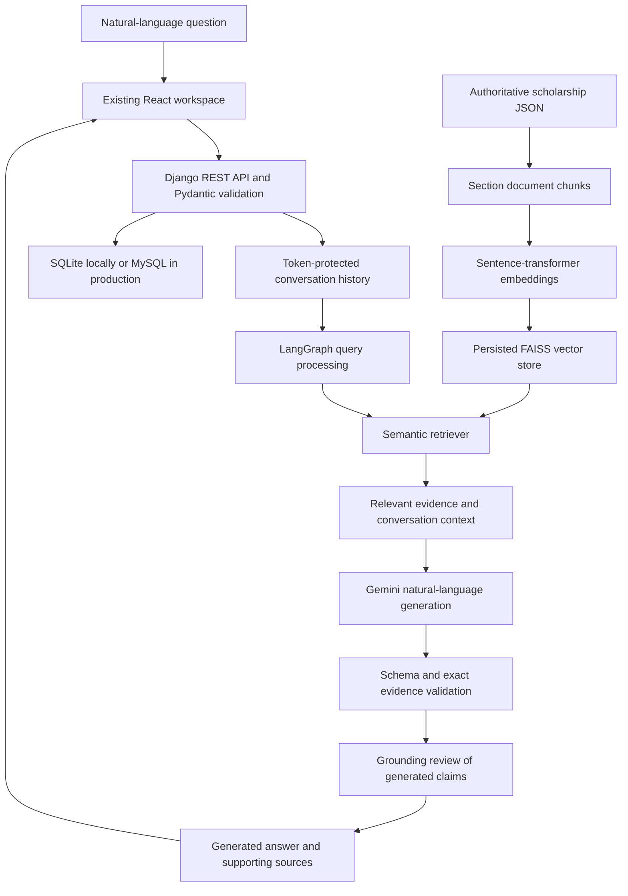

# Conversational RAG architecture

The bounded graph is plan -> retrieve -> answer. It does not invoke a rule engine,
create a personal profile, or adjudicate eligibility. SQL stores operational corpus
metadata, conversation messages, executions/tool audit rows, provider usage by
phase, and evaluations. The corpus and vector index retain their original roles.

The actual draft.answer survives validation unchanged into the API and React.
The server derives source metadata from verified references. Failed retrieval or
LLM calls return errors rather than replacing generated language with source dumps.
